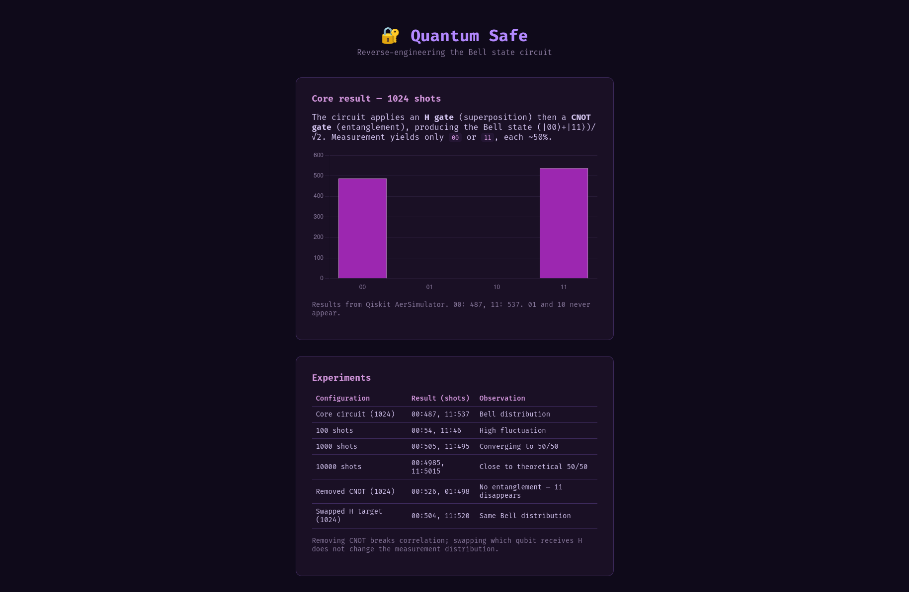
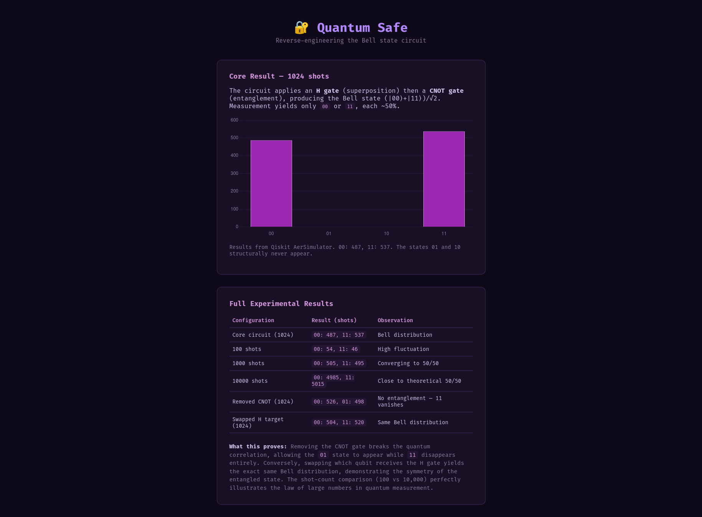

# 🔐 Quantum Safe — Bell State Solution

> Qiskit Fall Fest Nairobi 2026 Hackathon — Challenge 03: Quantum Safe  
> Key concepts: Quantum Gates, Circuits

[](https://github.com/quantumke-org/Qiskit-Fall-Fest-Nairobi-2026-Hackathon-Prompts/blob/main/challenges/03-quantum-safe.md)
[](https://qiskit.github.io/qiskit-aer/tutorials/1_aersimulator.html)

---

## The Challenge

A "quantum safe" unlocks only when you prepare the correct quantum state. The target
measurement distribution is:

| Outcome | Probability |
|---------|-------------|
| `00`    | 50%         |
| `11`    | 50%         |
| `01`    | 0%          |
| `10`    | 0%          |

`01` and `10` must **never** appear. The allowed gates are H, X, Z, CNOT, and measurement.

- Prompt repository: [quantumke-org/Qiskit-Fall-Fest-Nairobi-2026-Hackathon-Prompts](https://github.com/quantumke-org/Qiskit-Fall-Fest-Nairobi-2026-Hackathon-Prompts)
- Challenge file: [03-quantum-safe.md](https://github.com/quantumke-org/Qiskit-Fall-Fest-Nairobi-2026-Hackathon-Prompts/blob/main/challenges/03-quantum-safe.md)

---

## Installation & Setup

To run the notebook and experiments locally, follow these steps:

```bash
# 1. Clone the repository
git clone https://github.com/zaephyrz/quantum-safe.git
cd quantum-safe

# 2. Create a Python virtual environment
python3 -m venv .venv

# 3. Activate the virtual environment
# On Linux / macOS:
source .venv/bin/activate
# On Windows:
# .venv\Scripts\activate

# 4. Install the required dependencies
pip install 'qiskit[visualization]' qiskit-aer jupyter
```

Once the dependencies are installed, launch the notebook to view the circuit and experiments:

```bash
jupyter notebook quantum-safe.ipynb
```

---

## The Solution

Two gates, applied in order:

```python
from qiskit import QuantumCircuit, transpile
from qiskit_aer import AerSimulator

qc = QuantumCircuit(2)
qc.h(0)          # superposition on qubit 0
qc.cx(0, 1)      # entangle qubit 1 with qubit 0
qc.measure_all()

sim = AerSimulator()
result = sim.run(transpile(qc, sim), shots=1024).result()
counts = result.get_counts()
print(counts)    # e.g. {'00': 487, '11': 537}
```

### Why it works — step by step

**Initial state:** `|00⟩`.

**After H(0):** qubit 0 becomes `(|0⟩ + |1⟩)/√2`, qubit 1 stays `|0⟩`:

```
(|0⟩ + |1⟩)/√2 ⊗ |0⟩  =  (|00⟩ + |10⟩)/√2
```

At this point, measuring qubit 0 gives 0 or 1 with equal probability, but the two
qubits are **not yet correlated**.

**After CNOT(0 → 1):** qubit 0 controls whether qubit 1 flips.

- The `|00⟩` branch: control is `0` → target stays `0` → `|00⟩`
- The `|10⟩` branch: control is `1` → target flips `0 → 1` → `|11⟩`

Resulting state:

```
(|00⟩ + |11⟩)/√2
```

This is the Bell state `|Φ⁺⟩`. Measurement can only yield `00` or `11`, each 50%.
The `01` and `10` outcomes are **structurally forbidden** by the entanglement.

> The CNOT gate does not "create" correlation from nothing — it converts a
> **single-qubit superposition** into a **joint two-qubit superposition**. This is
> the core conceptual point.

The Qiskit Aer tutorial uses this exact circuit as its introductory Bell-state
example: `circ.h(0)`, `circ.cx(0, 1)`, `circ.measure_all()`, producing the state
`(|0,0⟩ + |1,1⟩)/√2` [1]. A 2026 EPJ paper on Qiskit measurement visualization
likewise uses Bell states to demonstrate entanglement and correlation patterns in
measurement histograms [3].

---

## Code Walkthrough

| Line | What it does | Why it matters |
|------|-------------|----------------|
| `QuantumCircuit(2)` | Creates two qubits | The safe has two output bits |
| `qc.h(0)` | Hadamard on qubit 0 | Puts qubit 0 into `(\|0⟩+\|1⟩)/√2` |
| `qc.cx(0, 1)` | CNOT, control = 0, target = 1 | Entangles the pair into `(\|00⟩+\|11⟩)/√2` |
| `qc.measure_all()` | Measures both qubits | Collapses the state into classical `counts` |
| `AerSimulator()` | Local ideal simulator | No real hardware queue; ideal for experimentation |
| `transpile(qc, sim)` | Converts circuit to simulator basis | Standard Qiskit Aer workflow |
| `sim.run(..., shots=1024)` | Repeats the circuit 1024 times | Each shot collapses to one outcome; statistics emerge |
| `result.get_counts()` | Returns `{bitstring: count}` | The measurement distribution the safe checks |

---

## Experiments & Results

I ran the core circuit and three controlled variations to verify that the
correlation comes from the CNOT gate and not from the H gate alone.

| Configuration | Result (shots) | Observation |
|---------------|----------------|-------------|
| **Core circuit (1024)** | `00: 487`, `11: 537` | Bell distribution |
| 100 shots | `00: 54`, `11: 46` | High fluctuation |
| 1000 shots | `00: 505`, `11: 495` | Converging toward 50/50 |
| 10000 shots | `00: 4985`, `11: 5015` | Close to theoretical 50/50 |
| **Removed CNOT (1024)** | `00: 526`, `01: 498` | `11` disappears — no entanglement |
| **Swapped H target (1024)** | `00: 504`, `11: 520` | Same Bell distribution |

### What the experiments show

1. **Shot-count convergence (law of large numbers).** At 100 shots, the split was
   `54/46`. At 10,000 shots, it was `49.85/50.15` — much closer to the true 50/50
   theoretical probability. Furthermore, running five independent 100-shot trials
   yielded splits ranging from `43/57` to `57/43`, proving that single small samples
   are highly volatile. Each shot collapses the quantum state to one classical outcome; 
   more shots give a more reliable estimate of the underlying probabilities.

2. **CNOT is the source of correlation.** Without `qc.cx(0, 1)`, the circuit
   produces `00` and `01` (not `00` and `11`). The H gate alone creates
   superposition on qubit 0, but qubit 1 never flips, so `11` cannot occur.

3. **The Bell state is symmetric under qubit relabeling.** Applying H to qubit 1
   instead (`qc.h(1); qc.cx(1, 0)`) still yields `00/11` at ~50%. The measurement
   distribution does not depend on which qubit "receives" the superposition.

---

## Visualizations

### Jupyter Notebook Output


The image above shows the execution of `quantum-safe.ipynb`. It displays the raw text output for the core circuit, shot-count comparisons, the five independent runs, the removed-CNOT circuit, and the swapped-H circuit. Below the text output, a three-panel histogram visualizes the stark difference in measurement distributions between the three circuit configurations.

### Web Interface


You can view the interactive version of this data live on GitHub Pages: **[Quantum Safe Web Demo](https://zaephyrz.github.io/quantum-safe/)**

The web interface provides a beautifully themed, interactive view of the core measurement histogram and a detailed breakdown of the experimental results, making the quantum correlations easy to explore.

---

## Real-World Connection

The two-qubit Bell state in this challenge is the same entanglement structure used in
deployed quantum-safe systems:

- **Entanglement-based QKD (Ekert91).** Entangled photon pairs are split between two
  parties. The correlation between their measurement results serves as an
  eavesdropping test — any interception disturbs the entanglement and is detectable
  [4].

- **1,000-kilometre quantum-secure network (2026).** India demonstrated a
  national-scale QKD network, moving quantum key distribution from laboratory
  demonstration to infrastructure [4].

- **Hybrid QKD + PQC over deployed fiber.** A field-deployed system in Thuringia,
  Germany integrated entanglement-based QKD with end-to-end post-quantum
  cryptography over 140 km of installed fiber, connecting a rural health kiosk to a
  university hospital, with 22 days of continuous autonomous operation [5].

- **Post-quantum cryptography (PQC).** NIST finalized ML-KEM, ML-DSA, and SLH-DSA in
  August 2024, and NSA's CNSA 2.0 mandates replacement of vulnerable algorithms in
  national security systems by 2030 [4].

The state `(|00⟩ + |11⟩)/√2` is the ideal mathematical description of the
entanglement source at the heart of these systems.

---

## References

1. Qiskit AerSimulator tutorial — official Qiskit documentation  
   <https://qiskit.github.io/qiskit-aer/tutorials/1_aersimulator.html>

2. CERN International Quantum Center, "Practical Guide to Using a Quantum Computer" (2026)  
   <https://zenodo.org/records/18861492>

3. Pandey & Porwal, "Qubit Measurement Visualization in Default, Single and Multiple-Qubit System using Qiskit," EPJ Web of Conferences (2026)  
   <https://www.epj-conferences.org/articles/epjconf/pdf/2026/16/epjconf_quick2026_01028.pdf>

4. QNu Labs, "From BB84 to 1,000 Kilometres: Quantum Security Has Entered Its Next Chapter" (2026)  
   <https://www.qnulabs.com/blog/bb84-to-1000km-quantum-security-next-chapter>

5. Dosan et al., "Secure Medical Data Transmission Using Quantum Key Distribution and Post-Quantum Cryptography in Real-World Fiber Networks," arXiv:2608.18869 (2026)  
   <https://browse-export.arxiv.org/abs/2608.18869>

---

## Project Structure

```
quantum-safe/
├── index.html              # dark-purple static demo page (GitHub Pages entry)
├── quantum-safe.png        # screenshot referenced above
├── quantum-safe.ipynb      # Qiskit notebook with all experiments
├── README.md
└── .gitignore              # ignores .venv, __pycache__, .ipynb_checkpoints
```

---

## AI Disclosure

```text
AI Tool: DeepSeek

How I used it:
I used DeepSeek to understand the Bell state construction and to review my explanation of why CNOT creates measurement correlation. All code was executed and verified locally with Qiskit AerSimulator; the counts shown above are from my own runs, not AI-generated data.
```